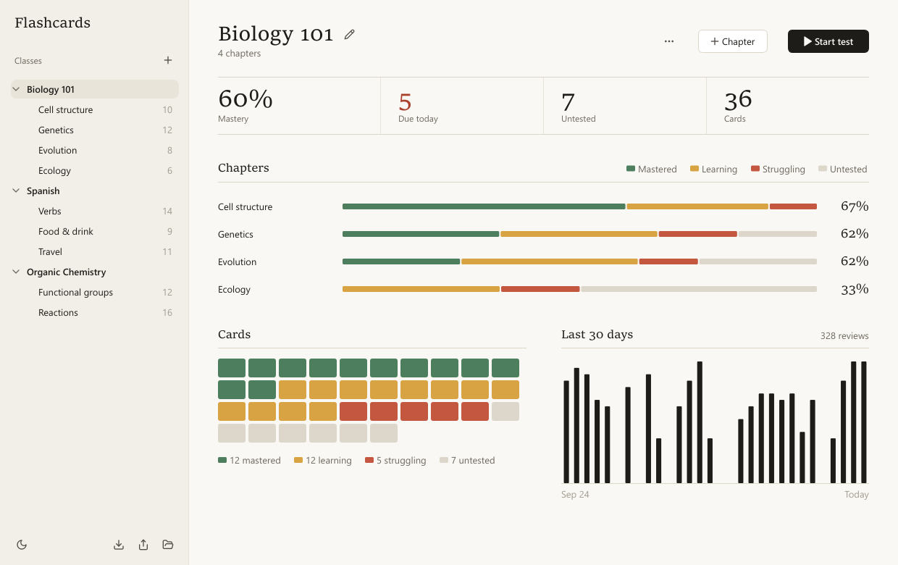
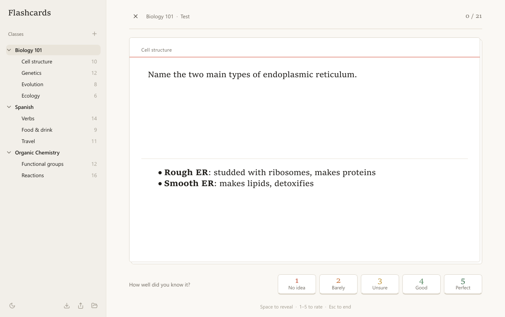
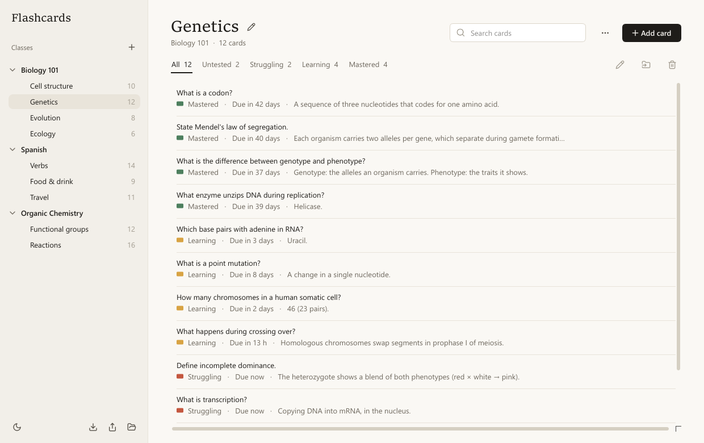

<div align="center">

# FlashPack

**A desktop flashcard app in the spirit of Anki.**<br>
Organise cards by class and chapter, rate how well you knew each one, and let spaced
repetition decide what to test next. Everything stays on your machine.


[Features](#features) · [Getting started](#getting-started) · [Shortcuts](#keyboard-shortcuts) ·
[Scheduling](#how-cards-are-chosen) · [Your data](#your-data) · [Development](#development)

<br>

<picture>
  <source media="(prefers-color-scheme: dark)" srcset="docs/screenshots/dashboard-dark.png">
  
</picture>

</div>

## Features

- **Rich cards.** Both sides support bold, italic, underline, strikethrough, headings,
  lists, text colours, highlights and images (paste, drag in or insert).
- **Confidence ratings.** Rate each answer from 1 to 5: *No idea*, *Barely*, *Unsure*,
  *Good*, *Perfect*.
- **Smart tests.** Start a test from a class and choose its chapters. Due and weak cards
  come first, then untested ones. Cards you miss come back later in the same session.
- **Class dashboard.** Mastery, cards due today, untested cards, each chapter's status mix,
  every card as a coloured tile, and reviews over the last 30 days. Hover for details;
  click a chapter to open it.
- **Easy to reorganise.** Drag cards onto a chapter in the sidebar, move chapters between
  classes, reorder them, and rename anything inline.
- **Light and dark themes.** Follows your system setting until you pick one.
- **Local and portable.** One SQLite database plus an image folder. Export everything to a
  single `.flashpack` file and import it on another device.

<p align="center">
  <picture>
    <source media="(prefers-color-scheme: dark)" srcset="docs/screenshots/test-dark.png">
    
  </picture>
  <picture>
    <source media="(prefers-color-scheme: dark)" srcset="docs/screenshots/chapter-dark.png">
    
  </picture>
  <br>
  <sub>A test with the answer revealed &nbsp;·&nbsp; A chapter's cards, filterable by status</sub>
</p>

## Getting started

You need **Python 3.10 or newer** (developed on 3.12). PyQt6 is the only dependency.

```bash
git clone https://github.com/BruhClient/FlashPack.git
cd FlashPack
python -m venv venv
venv\Scripts\activate          # Windows
# source venv/bin/activate     # macOS / Linux
pip install -r requirements.txt
python main.py
```

### First steps

1. Click **+** next to *Classes* in the sidebar to create a class.
2. Open the class and click **Chapter** to add chapters.
3. Select a chapter and click **Add card**. Use *Save & add another* to enter several in a
   row.
4. Go back to the class and click **Start test**. Pick the chapters and the session size,
   then go.
5. Press <kbd>Space</kbd> to reveal the answer, then <kbd>1</kbd>–<kbd>5</kbd> to rate it.

To rename a class or chapter, click its title on its page, or double-click it in the
sidebar (or press <kbd>F2</kbd>). The **⋯** buttons hold everything else.

## Keyboard shortcuts

| Where        | Keys                                                            | Action                       |
|--------------|-----------------------------------------------------------------|------------------------------|
| Anywhere     | <kbd>Ctrl</kbd>+<kbd>Shift</kbd>+<kbd>N</kbd>                   | New class                    |
|              | <kbd>Ctrl</kbd>+<kbd>E</kbd> / <kbd>Ctrl</kbd>+<kbd>I</kbd>     | Export / import data         |
|              | <kbd>Ctrl</kbd>+<kbd>Shift</kbd>+<kbd>L</kbd>                   | Toggle light / dark          |
|              | <kbd>Ctrl</kbd>+<kbd>Q</kbd>                                    | Quit                         |
| Sidebar      | <kbd>F2</kbd> or double-click                                   | Rename                       |
| Chapter page | <kbd>Ctrl</kbd>+<kbd>N</kbd>                                    | Add card                     |
|              | <kbd>Ctrl</kbd>+<kbd>F</kbd>                                    | Search cards                 |
|              | <kbd>Enter</kbd> / <kbd>Delete</kbd>                            | Edit / delete selected cards |
| Card editor  | <kbd>Ctrl</kbd>+<kbd>Enter</kbd>                                | Save                         |
|              | <kbd>Ctrl</kbd>+<kbd>Shift</kbd>+<kbd>Enter</kbd>               | Save and add another         |
|              | <kbd>Ctrl</kbd>+<kbd>B</kbd> / <kbd>I</kbd> / <kbd>U</kbd>      | Bold / italic / underline    |
|              | <kbd>Ctrl</kbd>+<kbd>Shift</kbd>+<kbd>X</kbd>                   | Strikethrough                |
|              | <kbd>Ctrl</kbd>+<kbd>Shift</kbd>+<kbd>8</kbd> / <kbd>7</kbd>    | Bulleted / numbered list     |
|              | <kbd>Ctrl</kbd>+<kbd>&#92;</kbd>                                | Clear formatting             |
| Test         | <kbd>Space</kbd> or <kbd>Enter</kbd>                            | Show answer                  |
|              | <kbd>1</kbd>–<kbd>5</kbd>                                       | Rate                         |
|              | <kbd>Esc</kbd>                                                  | End the test                 |

## How cards are chosen

Scheduling is a variant of SM-2, adapted to the 1–5 scale
([`flashcards/scheduler.py`](flashcards/scheduler.py)).

| Rating           | What happens                                                                                                                                                          |
|------------------|-----------------------------------------------------------------------------------------------------------------------------------------------------------------------|
| **1–2** (missed) | Due again in 10 minutes, and returns 3–5 cards later in the current test until you rate it 3 or higher.                                                               |
| **3–5**          | Next review in 1 day, then 3 days (6 if you rated it 4–5), then the previous interval × the card's *ease*. A 3 shortens that interval (×0.8); a 5 lengthens it (×1.3). |

**Ease** starts at 2.5. A 5 raises it, a 4 keeps it, and 3 or lower reduces it, never below
1.3. Only a card's first rating in a test changes its ease.

When you start a test, the session is filled in this order:

1. **Due cards**, most urgent first. Urgency combines how overdue a card is with how weak
   it is (low last rating, low ease).
2. **Untested cards**, oldest first, if *Include untested cards* is on.
3. **Not-yet-due cards** you're most likely to have forgotten, if there's still room.

### Card status and mastery

| Status         | Meaning                                                        |
|----------------|----------------------------------------------------------------|
| **Untested**   | Never reviewed                                                 |
| **Struggling** | Last rated 1–2                                                 |
| **Learning**   | Reviewed, but not yet mastered                                 |
| **Mastered**   | Last rated 4–5 **and** its review interval has reached 21 days |

A card's mastery is half your last confidence and half how long the card has held up
(interval out of 21 days). A chapter's or class's mastery is the average over its
*tested* cards. Untested cards are counted separately, so they don't pull the score down.

## Your data

Everything lives in one folder; the folder button at the bottom of the sidebar opens it.

| OS      | Default location                         |
|---------|------------------------------------------|
| Windows | `%APPDATA%\Flagship`                     |
| macOS   | `~/Library/Application Support/Flagship` |
| Linux   | `~/.local/share/Flagship`                |

Set the `FLAGSHIP_DATA_DIR` environment variable to use a different folder. Inside it:

| Path            | Contents                                                                     |
|-----------------|------------------------------------------------------------------------------|
| `flashcards.db` | Classes, chapters, cards and review history (SQLite)                         |
| `media/`        | Images used on cards. Images no card uses any more are cleaned up at startup |
| `backups/`      | Automatic backups made before a *Replace everything* import                  |

### Moving to another device

1. **Export** (<kbd>Ctrl</kbd>+<kbd>E</kbd>, or the share icon in the sidebar). This writes
   a `.flashpack` file: a zip of your data (`data.json`) and images.
2. **Import** (<kbd>Ctrl</kbd>+<kbd>I</kbd>) on the other device and choose a mode:
   - **Merge** adds the file's classes next to the ones you already have. Clashing names
     get a suffix.
   - **Replace everything** swaps your data for the file's. Your current data is saved to
     `backups/` first.

You can also copy the whole data folder while the app is closed.

## Development

```bash
pip install pytest
python -m pytest
```

The tests cover the scheduler, the database layer, the statistics and export/import. The
logic modules in `flashcards/` don't import Qt; the widgets live in `flashcards/ui/`.

UI colours always come from the tokens in `ui/theme.py`, through `theme.color(key)` in code
or `$token` in `style.qss`. When changing the UI, check it in both themes.

<details>
<summary><b>Project layout</b></summary>

```
main.py                 entry point: picks the data folder, applies the theme, opens the window
flashcards/
  models.py             dataclasses for classes, chapters, cards and reviews
  db.py                 SQLite schema and queries
  scheduler.py          spaced-repetition rules and test-session selection
  stats.py              card status, mastery and dashboard aggregates
  media.py              image storage and cleanup
  transfer.py           .flashpack export / import
  ui/
    main_window.py      sidebar + page stack, export/import, shortcuts
    sidebar.py          class / chapter tree, rename, reorder, card drops
    class_dashboard.py  class page with figures and charts
    chapter_view.py     card list, search, filters, move dialog
    card_editor.py      add / edit card dialog
    rich_text.py        rich text editor and card viewer
    test_setup.py       choose chapters and session size
    test_session.py     the test itself and its summary
    charts.py           hand-painted chart widgets
    theme.py            light / dark colour tokens and fonts
    style.qss           stylesheet template filled from theme.py
    icons.py            inline SVG icons, recoloured per theme
    animations.py       fades, count-ups and page transitions
    dialogs.py          shared buttons, dialogs and small widgets
    toast.py            brief confirmation messages
tests/                  pytest suite
docs/screenshots/       images used in this README
```

</details>
